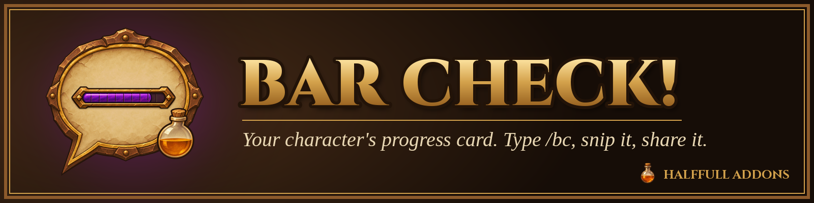
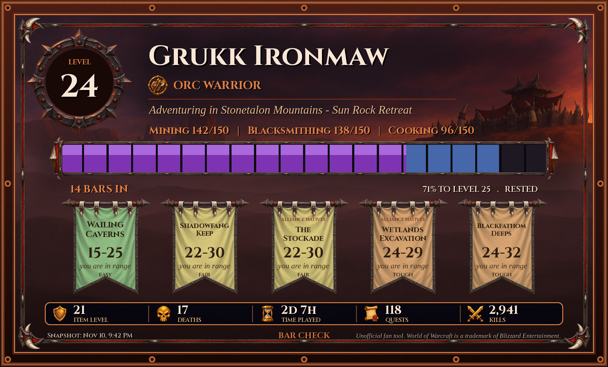

**Bar Check** turns your WoW: Forever character into a shareable progress card. Type `/bc`, watch the card build itself, snip it, and paste it into Discord.

*Preview renders made from the addon's own art and layout. In-game screenshots coming soon.*

- Level, race, class, zone and professions
- 20-segment XP bar with rested XP
- Dungeons in reach for your level, with level ranges and difficulty
- Stats strip: item level, deaths, time played, quests, kills, optional gold
- Characters list, Bar Check! chat button, Options window

**Commands:** `/bc` · `/bc <name>` · `/bc list` · `/bc options` · `/bc shout` · `/bc reset`

Download on CurseForge (coming soon). Bugs and ideas: open an issue here or comment on the CurseForge page.

Unofficial fan tool. World of Warcraft is a trademark of Blizzard Entertainment. Not affiliated with or endorsed by Blizzard. MIT license.

Part of the **HalfFull Addons** family.
